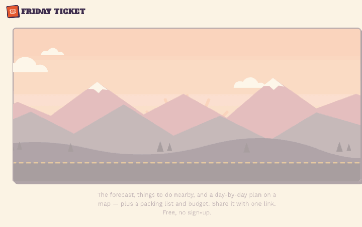
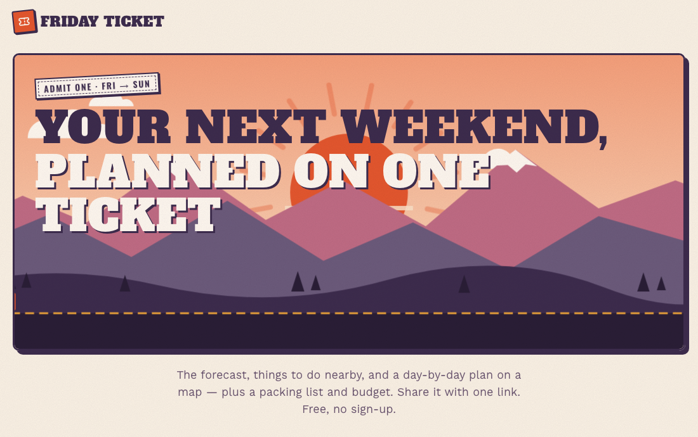
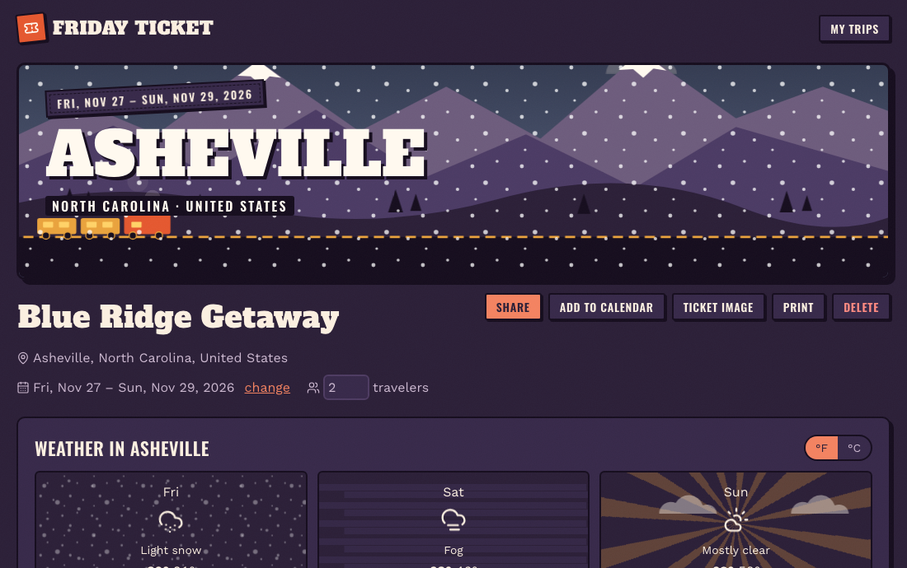

# Friday Ticket — Weekend Trip Planner

[](https://github.com/Prestoj01/weekend-trip-planner/actions/workflows/deploy.yml)

Plan a weekend away on one page: the forecast, things to do nearby, a day-by-day itinerary on a map, a packing list and a budget. Styled like a vintage travel poster. Free, no sign-up, no API keys.

**Live demo:** https://prestoj01.github.io/weekend-trip-planner/ (try **"explore a sample trip"**)



## Features

**Planning**

- **Plan my weekend.** One click fills open time slots from nearby places. The arrival day starts mid-afternoon and the departure day ends after lunch. Rainy days get indoor picks, and consecutive stops are chosen close together. It runs on plain rules, with no AI service.
- **Itinerary.** Days are laid out as ticket stubs. Stops have times, costs and notes, and the app estimates the walk or drive time between them.
- **Drag and drop.** Stops can be moved between days, or reordered within a day while the time slots stay put. Works with mouse, touch and keyboard.
- **Things to do nearby.** Sights, outdoors spots, and food and drink come from OpenStreetMap, with notable places (those with a Wikipedia link) ranked first. Results are cached per city and fail over across mirrors. The sample trip still works when the service is down.
- **Map.** Each day's route draws itself in that day's colour, and a marker travels it stop to stop.
- **Weather.** A 16-day forecast with sunrise and sunset. Each tile animates its conditions: rain, snow, fog, sun rays or lightning.
- **Packing list.** Suggests items from the forecast, stamps "PACKED" on checked items, and sets off confetti when everything is packed.
- **Budget.** Totals per day and per person.

**Sharing**

- **Share links.** The whole trip is compressed into the URL; anyone can open it read-only and save a copy.
- **Ticket image.** A 1080×1350 "admit one" ticket with a scannable QR code (shared via the share sheet on phones).
- **Calendar file** (`.ics`) and a print layout.

**Feel**

- **Destination poster.** Each trip gets its own animated scene. The terrain follows the destination's elevation (mountains, hills, or a waterfront skyline), and the sky follows the forecast.
- **Dark mode.** "Dusk" mode shows the same poster after sundown.
- **Undo.** Deleting a trip, stop or packing item shows a toast with an Undo button instead of a confirm dialog.
- **Works offline.** It's an installable PWA, so saved trips open with no signal.

|                                 |                                              |
| ------------------------------- | -------------------------------------------- |
|           |      |

## Engineering notes

- **No backend, no keys.** All data comes from free, keyless APIs: [Open-Meteo](https://open-meteo.com) for geocoding and forecasts, and the [Overpass API](https://wiki.openstreetmap.org/wiki/Overpass_API) for places. Trips are stored in `localStorage`. The whole site is static files on GitHub Pages, so it costs nothing to run and has no secrets to leak.
- **Two share formats.** The full format is `lz-string`-compressed JSON. A compact positional format (`2.` prefix) is about 70% shorter, which keeps the ticket's QR code scannable. `decodeTrip` reads both and validates the structure.
- **Pure, tested core.** Planning, drag-and-drop moves, travel estimates, rescheduling, budget, `.ics` export, share encoding and the suggestion cache are all plain functions in `src/lib`, covered by Vitest.
- **End-to-end tests.** Playwright runs on desktop and mobile against the production build. Open-Meteo, Overpass and map tiles are mocked, so runs are fast and deterministic. The suite covers trip creation, the planner, drag and drop (mouse and keyboard), undo, the share round trip, OpenStreetMap outages, offline reloads, and decoding the ticket's QR code with `jsQR`.
- **Performance.** Leaflet and the ticket renderer load on demand (the main bundle is about 89 KB gzipped). Decorative animation pauses when scrolled out of view.
- **Accessibility.** The app supports keyboard drag-and-drop, the ARIA combobox pattern, `prefers-reduced-motion`, and WCAG AA colour contrast, which was checked for every palette pair, including the tinted weather tiles.
- **Generated assets.** The social preview image, the PWA icons and the media in this README are rendered from the real UI by Playwright (`MEDIA=1`), so they stay in sync with the design.

| Concern | Choice                                                                         |
| ------- | ------------------------------------------------------------------------------ |
| UI      | React 19, TypeScript, Vite; Lucide icons; Fontsource (Alfa Slab One, Oswald, Work Sans) |
| Map     | Leaflet / react-leaflet, OpenStreetMap tiles                                   |
| DnD     | dnd-kit                                                                        |
| Offline | vite-plugin-pwa (Workbox)                                                      |
| Tests   | Vitest, Playwright, oxlint, strict TypeScript                                  |
| CI/CD   | GitHub Actions: lint → unit → build → e2e → deploy to GitHub Pages             |

## Project structure

```
src/
  components/   Home, HeroScene, TripView, Itinerary (dnd), TripMap, Suggestions, Packing, Budget, Toast…
  hooks/        useTrips, useForecast, useHashRoute, useTilt, useOffscreenPause
  lib/          Pure logic: planner, travel, trip, dates, api (+cache), storage/share, ics, scene, ticketImage
e2e/            Playwright specs, API fixtures, and media generators
```

## Development

```bash
npm install
npm run dev          # http://localhost:5173/weekend-trip-planner/
npm test             # unit tests
npm run test:e2e     # Playwright (builds and serves the production bundle)
npm run lint
npm run build

# Regenerate the social image, icons and README media
MEDIA=1 npx playwright test e2e/media.spec.ts e2e/icons.spec.ts --project=desktop
```

## Deployment

Each push to `main` runs [`.github/workflows/deploy.yml`](.github/workflows/deploy.yml) and deploys to GitHub Pages. One-time setup: **Settings → Pages → Build and deployment → Source: GitHub Actions**.

## Attribution

Weather data by Open-Meteo (CC BY 4.0). Map data © OpenStreetMap contributors (ODbL).
